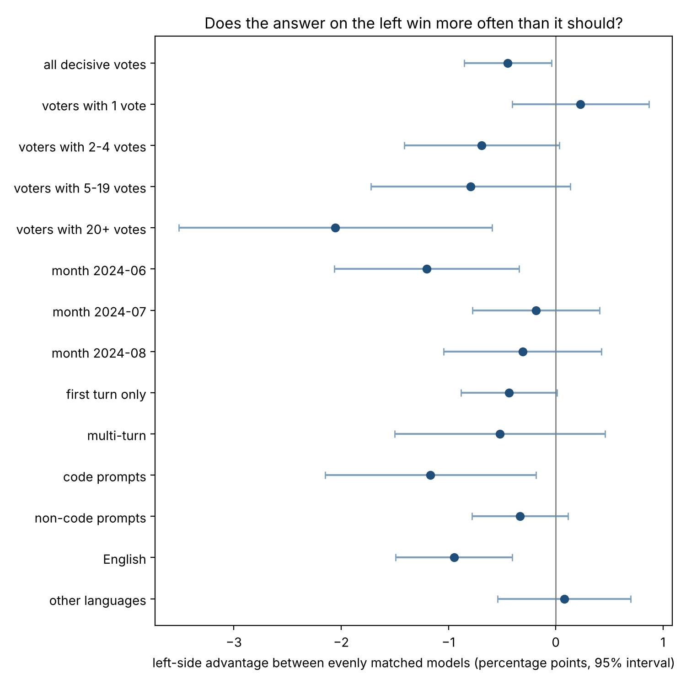

# arena-order-effects

Does the answer shown on the **left** win more often than it should?

LMArena (Chatbot Arena) shows two anonymous model answers side by side and asks a person to vote. The open-source arena code assigns the two models to the left and right at random (`swap = np.random.randint(2)` in FastChat's `gradio_block_arena_anony.py`), so the public votes are a natural experiment on side preference in human judging.

This project measures that side effect on the public vote data, with a model that also accounts for how strong each model is.

## Method

Each decisive vote compares the left model with the right model:

```
log-odds(left wins) = strength[left] - strength[right] + gamma
```

- `strength` is the usual Bradley-Terry score for each model.
- `gamma` is the side effect. `gamma = 0` means the side does not matter.
- The model is fitted by maximum likelihood, with and without `gamma`, and the two fits are compared with a likelihood-ratio test (1 degree of freedom).
- Votes from the same person are not independent, so the interval for `gamma` is also computed by resampling whole voters.
- A separate check asks whether individual voters differ in how often they pick the left side.
- The fit is repeated with answer length held fixed (log ratio of the two answers' token counts), which also gives a yardstick: how large is the side effect next to the known preference for longer answers?

Ties are left out of the main fit and reported as a share.

## Data

`lmarena-ai/arena-human-preference-100k` on Hugging Face (about 106,000 votes, June to August 2024). `scripts/make_extract.py` downloads it and keeps only the columns needed here. No conversation text is stored in this repository.

## Run it

On Windows, double-click `run_all.bat`. On any system:

```
pip install -r requirements.txt
python scripts/make_extract.py        # writes data/votes.csv.gz
python scripts/run_analysis.py        # writes results/
pytest -q                             # checks the estimator on simulated votes
```

To see the pipeline without downloading anything:

```
python scripts/run_analysis.py --simulate 0.1
```

## Results

106,134 public votes from June to August 2024; 64,643 of them are decisive (not ties) and involve models that appear on both sides.

**The side barely matters, and if anything the right answer has a slight edge.** Between evenly matched models the left answer wins 49.55% of the time: a deficit of 0.45 percentage points (95% interval 0.04 to 0.85, p = 0.03). Resampling whole voters gives almost the same interval. With this much data, any side effect larger than about 0.6 points would have been detected.



| | Result |
|---|---|
| Left answer wins, evenly matched models | 49.55% |
| Same, holding answer length fixed | 49.52% |
| An answer twice as long as its rival wins | 58.5% |
| Length difference worth as much as the side | about 4% longer |
| Models whose leaderboard rank changes when the side is modelled | 2 of 53, by one place each |

**How to read it**

- **Small next to what else moves votes.** Being twice as long is worth about 8.5 points; being on the right is worth about half a point.
- **The leaderboard is safe.** Sides are randomized, so the effect washes out of the rankings.
- **It is concentrated in repeat voters.** People who cast one vote show no side preference (50.2% left). People with 20 or more votes pick the left answer only 47.9% of the time, and individual heavy voters differ from each other more than chance allows.
- **Treat the subgroups as leads, not findings.** The effect is larger in June, in English and on code prompts, but 14 groups were examined and the overall p-value is only 0.03. None of this was predicted in advance.

**Checks on the data**

- Two models (`eureka-chatbot`, `dbrx-next`; 1,322 votes) appear only on the right, so their battles are excluded. Including them does not change the estimate.
- For the other 53 models the share of appearances on the left runs from 48.4% to 53.0% among models with 1,000 or more votes, with mild imbalance overall (chi-square p = 0.03). The model adjusts for which model is on which side, so imbalance in how often a model appears left does not bias the estimate; it would only matter if the released data were filtered in a way that depends on both side and outcome.
- 38% of votes are ties and are not used.

## Files

| File | Purpose |
|---|---|
| `src/arena_order/bt.py` | The model: Bradley-Terry with a side term, likelihood-ratio test, voter-level bootstrap, voter check |
| `src/arena_order/simulate.py` | Fake votes with a known side effect, used by the tests |
| `scripts/make_extract.py` | Downloads the public votes and keeps the small columns |
| `scripts/run_analysis.py` | Runs everything and writes `results/` |
| `tests/test_bt.py` | Checks that the model recovers a planted effect and does not invent one |
| `run_all.bat` | Windows: install, download, analyze in one double-click |

The code is kept light on comments; this page is the explanation.

## Related work

- Chiang et al., *Chatbot Arena: An Open Platform for Evaluating LLMs by Human Preference* (arXiv 2403.04132). The paper swaps the order for its LLM judge "to avoid positional bias" and does not report a side effect for human votes.
- *What Wins a Vote?* (arXiv 2610.01316) reports no side effect in the French Compar:IA arena: model A wins 49.94% of decisive battles.

## Next

- Run an LLM judge on a sample of the same battles in both orders and put its side effect on the same scale as the human one.
- Test the repeat-voter pattern on a later data release, as a prediction this time.
